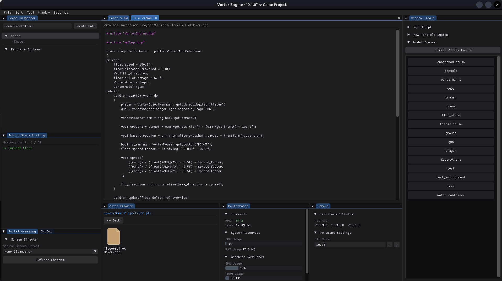
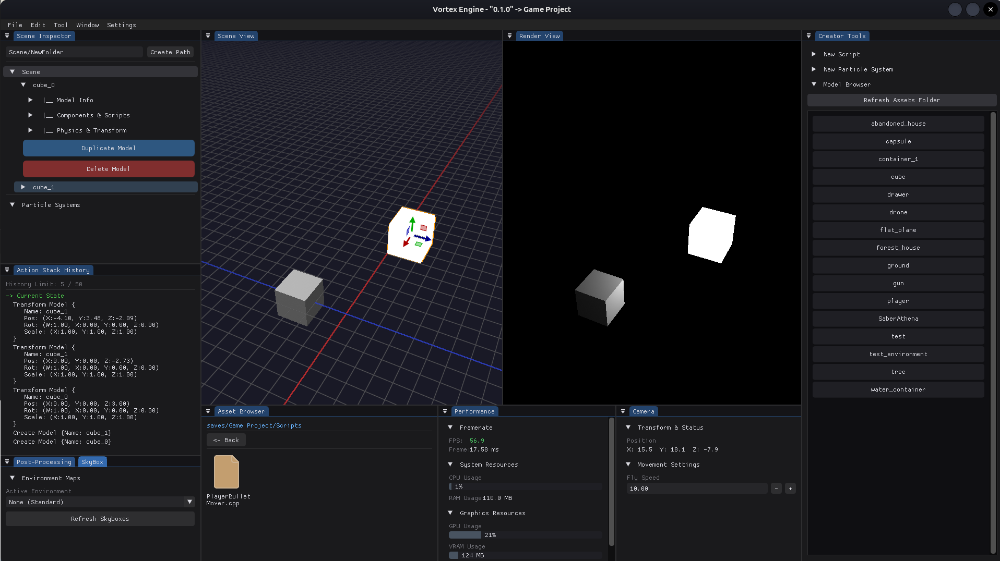
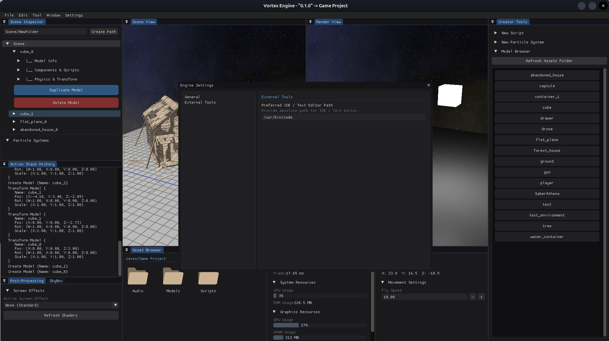
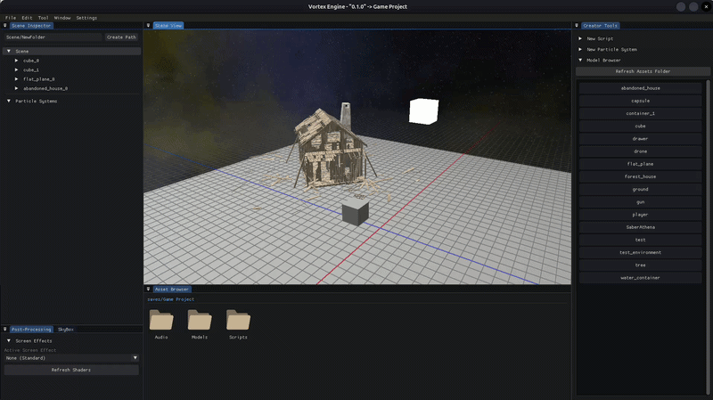

# Vortex Engine
**(Note: I am building this to learn engine architecture, openGL and in the future Vulkan, so expect rough edges as I figure out what I am doing!)**

<p align="center">
  
</p>

<p align="center">
  
</p>

<p align="center">
  
</p>

Vortex Engine is a personal project currently in its early development stages. It serves as a foundational bridge between basic rendering and a complete game engine, focusing heavily on low-level systems like memory management and pipeline optimization.

While many core features are working, the engine is actively evolving. Many standard features, including complex lighting and a scene hierarchy are on the roadmap. This project follows a bottom-up approach to ensure a fast, efficient, and highly optimized base for future implementations.

## Prerequisites
Vortex Engine is currently built for Linux (Ubuntu/Debian) and has Window support (might be buggy! :-) ).

## Installation and Building

The easiest way to get started is by running the included setup script. This script automatically fetches the required Linux headers and graphics libraries, compiles the engine, and sets up a desktop application shortcut so you can launch it directly from your app menu without using the terminal.

### Method 1: Automated Setup (Recommended)

1. **Clone the repository**

```bash
git clone git@github.com:Mashhood-Husnain/Vortex-Game-Engine.git
cd Vortex-Game-Engine
```

2. **Run the setup script**

Depending on your preferred shell, run either the Bash or Fish script. This handles all dependencies, compilation, and OS integration:

```bash
# For Bash users
chmod +x setup_linux.sh
./setup_linux.sh

# For Fish users
chmod +x setup_linux.fish
./setup_linux.fish
```

Once the script completes, you can simply open your Linux application menu, search for Vortex Engine, and launch it!

### Method 2: Manual Setup (Fallback)

If the setup script fails for some reason, or if you prefer to build the environment yourself, follow these manual steps.

see the **[BUILDING.md](docs/BUILDING.md)** for the full manual setup.

## Using the engine
### Scripting
All gameplay scripts are stored in the Vortex/Game/Scripts directory.
  - You can create new scripts directly through the engine's Creator Tool window.
  - Simply specify the name of the file, click create, and then open the file in your preferred IDE to write your C++ code.

### Keyboard Shortcuts & Controls
When you launch the engine, you will start in Editor Mode attached to the default camera. When you enter Play Mode, these default controls are disassociated from the camera so you can use them in your own game scripts.

See the **[full list of keyboard shortcuts](docs/CONTROLS.md)** for camera, object manipulation, panels, project, and play mode controls.


<p align="center">
  
</p>

<p align="center">
  
</p>

<p align="center">
  
</p>

<p align="center">
  
</p>

<p align="center">
  
</p>

<p align="center">
  
</p>
